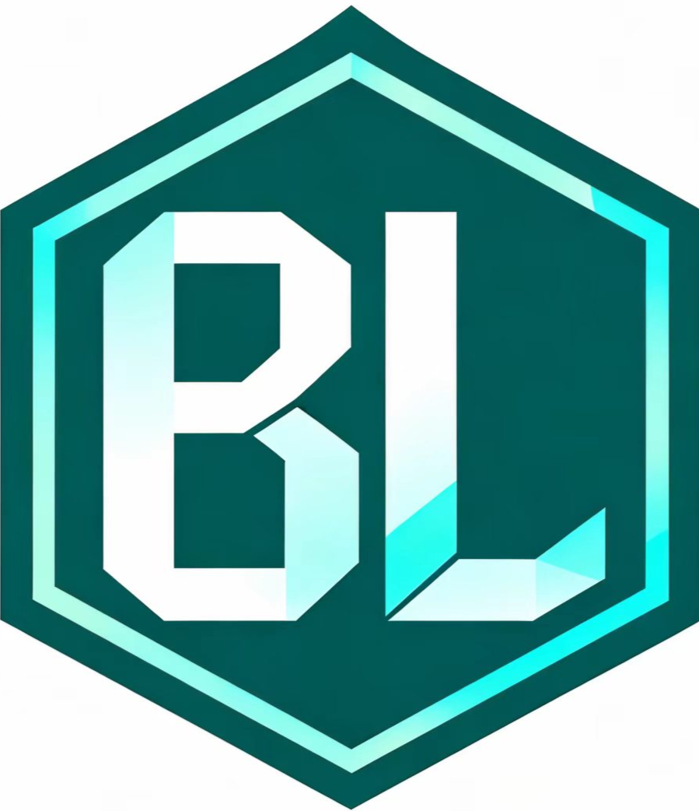
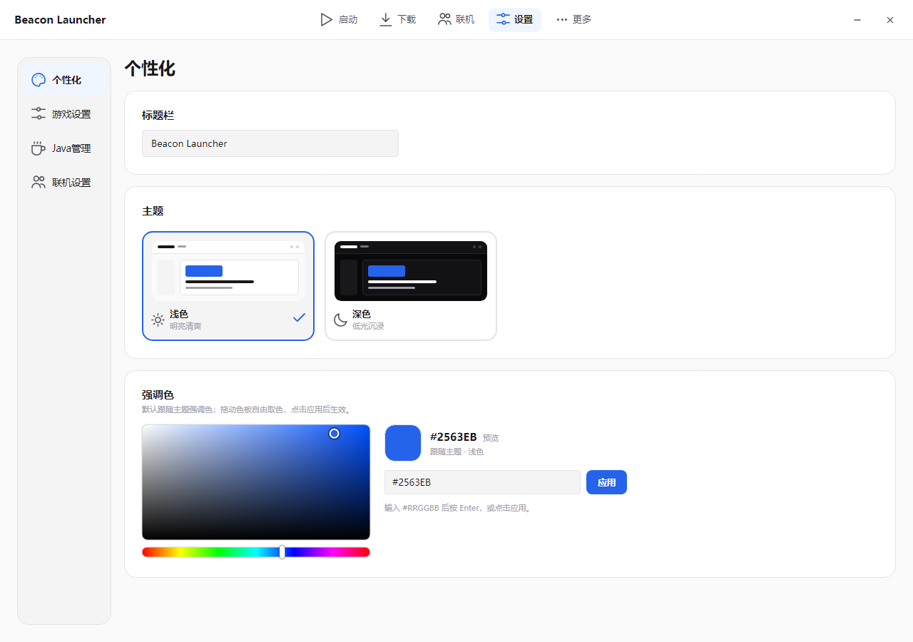
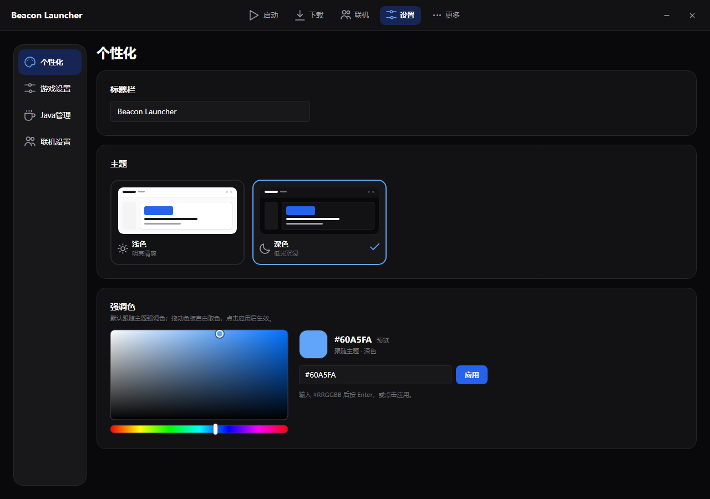

# Beacon Launcher



Beacon Launcher 是一个开源的 Minecraft: Java Edition 启动器，使用 [Avalonia UI](https://avaloniaui.net/) 12 和 .NET 10 构建。

[English](README.md)

> **当前状态：** 早期开发中。窗口外壳、设置页、浅色/深色主题、自定义强调色选择器和配置持久化已完成；微软账号登录、Java 管理、游戏下载和联机功能在计划中。

<p align="center">
  
  
</p>

## 功能

- 无边框、可拖动调整大小的窗口，自定义标题栏。
- 记住上次窗口大小（不记录位置），启动时居中。
- 基于语义色值 token 的浅色/深色主题。
- 真正的 HSV 强调色选择器：色板、色相条、十六进制输入和“跟随主题色”重置。
- 配置以原子写入方式保存在 `%APPDATA%\.bl\config.json`。
- 离屏 UI 截图工具，方便开发时检查界面。
- 不收集遥测数据。

## 环境要求

- Windows 10/11 x64（当前发布目标）
- .NET 10 SDK
- 可访问 NuGet 以还原 Avalonia 12 包

## 构建和运行

```powershell
dotnet build "Beacon Launcher.sln" -c Release
dotnet run --project "src/Beacon Launcher.UI/Beacon Launcher.UI.csproj"
```

发布自包含单文件 exe：

```powershell
dotnet publish "src/Beacon Launcher.UI/Beacon Launcher.UI.csproj" `
  -c Release -r win-x64 --self-contained true `
  -p:PublishSingleFile=true -p:PublishTrimmed=true -p:TrimMode=partial `
  -p:IncludeNativeLibrariesForSelfExtract=true -p:EnableCompressionInSingleFile=true `
  -o artifacts/publish
```

## 项目结构

```
src/Beacon Launcher.Core/   配置与持久化
src/Beacon Launcher.UI/     Avalonia 界面、主题、控件、视图
tools/UiSnapshot/           离屏 UI 渲染工具
docs/                       README 截图
```

## 离屏 UI 截图

`tools/UiSnapshot` 使用 Avalonia 的 headless 平台和 Skia 渲染真实界面，不会创建桌面窗口；默认使用临时配置目录，不会修改 `%APPDATA%\.bl\config.json`。

```powershell
dotnet run --project tools/UiSnapshot -c Release -- docs/screenshot.png `
  --settings --section personalization --width 1280 --height 800

dotnet run --project tools/UiSnapshot -c Release -- docs/dark.png `
  --theme dark --settings --section personalization --scroll bottom
```

## 微软账号登录

微软登录是启动器计划中的认证方式：使用官方 Microsoft 身份平台（`consumers` 租户），请求 `XboxLive.signin offline_access` scope，然后通过官方 Xbox Live/XSTS 和 Minecraft Services API 完成登录与启动。

启动器是公共客户端：不使用客户端密码，使用 localhost 回调 + PKCE，不绕过身份验证、所有权检查、许可证检查或其他安全机制，也不分发游戏文件。

## 隐私

见 [PRIVACY.zh-CN.md](PRIVACY.zh-CN.md)。当前版本只在本地保存设置，不收集遥测。

## 许可证

MIT，见 [LICENSE](LICENSE)。

## 声明

非 Minecraft 官方产品，与 Mojang Studios 或 Microsoft 无关联、未获其批准。“Minecraft” 是 Mojang Synergies AB 的商标。
